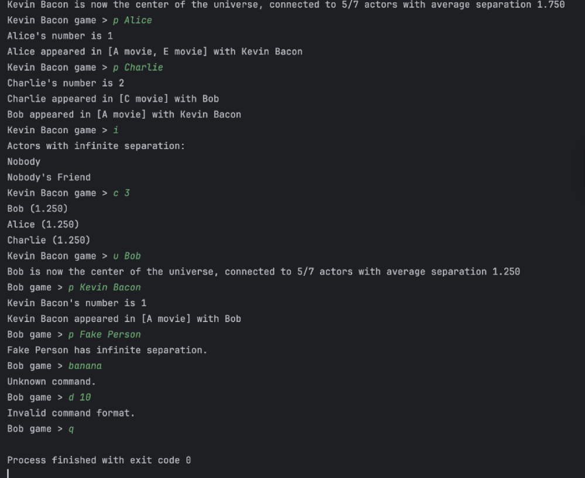
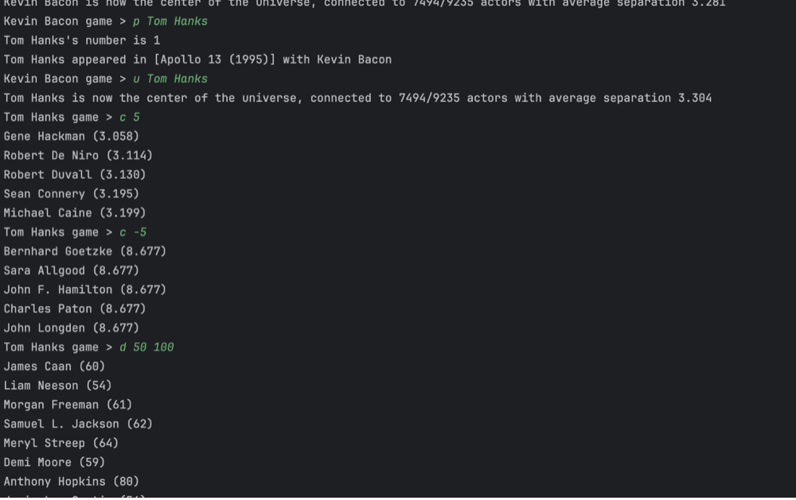
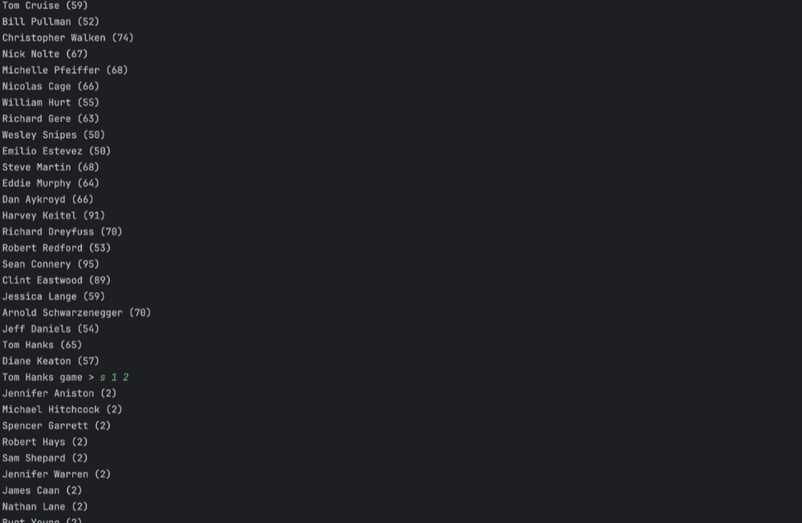
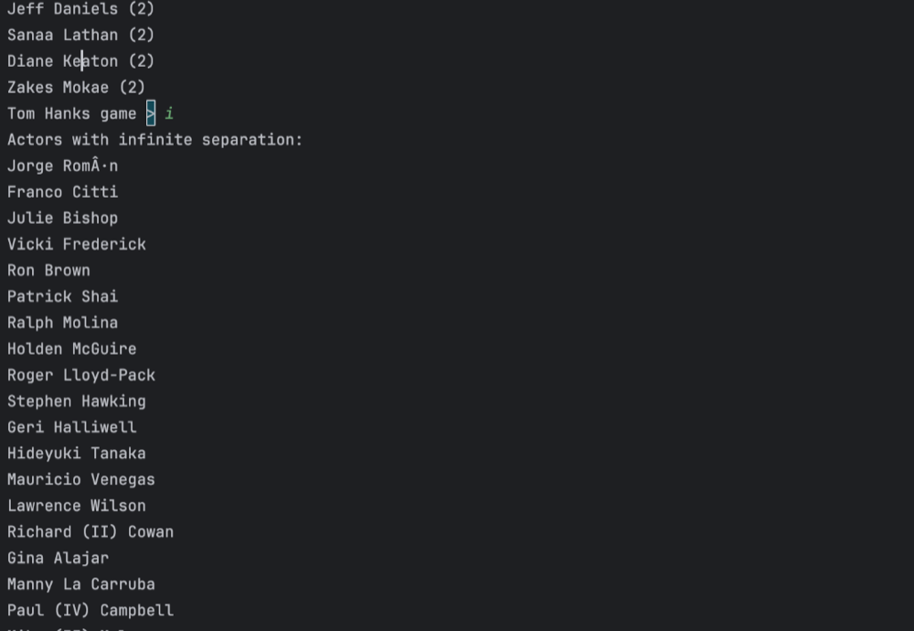

# Kevin Bacon Graph

A command-line Kevin Bacon game implemented in Java for Dartmouth CS 10.
The program models actors as vertices and connects two actors when they
appeared in the same movie. It can find shortest actor-to-actor paths,
inspect disconnected actors, and compare how centrally connected actors are.

## How it works

The project is split into three parts:

- **`BaconGraphBuilder`** reads actor, movie, and movie-cast records. It maps
  the input IDs to names, creates one vertex for every actor, and adds an
  undirected edge for each pair of actors who share a movie. Each edge is
  labeled with the set of movies shared by that pair.
- **`GraphLibrary`** provides graph algorithms independent of the movie
  domain. Its breadth-first search builds a shortest-path tree whose edges
  point from each discovered vertex to its parent. It also reconstructs paths,
  finds vertices missing from a connected subgraph, and calculates average
  separation from a root.
- **`BaconGame`** is the interactive command-line interface. It builds the
  graph, starts with Kevin Bacon as the center, and lets the user change the
  center, inspect paths and disconnected actors, and query degree, separation,
  and center rankings.

The BFS tree makes the shortest path from an actor to the current center
available by following parent edges. Average separation is the mean shortest
path length from a center to every other reachable actor; unreachable actors
are excluded from that calculation.

## Requirements

- Java 8 or newer
- The included `Graph.java` and `AdjacencyMapGraph.java` graph support classes
- The included small, fictional dataset in `demo-data/` for trying the game
- The larger CS 10 dataset at the project root for exploring the full graph

The graph support classes are from Dartmouth CS 10 and retain their original
attribution in the source files. The larger dataset is included for users who
are permitted to use and redistribute the course materials.

Each input file is pipe-delimited:

| File | Record format |
| --- | --- |
| `actors.txt` | `actorID|actorName` |
| `movies.txt` | `movieID|movieTitle` |
| `movie-actors.txt` | `movieID|actorID` |

## Build and run

From the project directory, compile and run with the included demo data:

```sh
javac Graph.java AdjacencyMapGraph.java BaconGraphBuilder.java GraphLibrary.java BaconGame.java
java BaconGame
```

The demo uses fictional actors and movie titles and starts with Kevin Bacon as
the center. To use the included full dataset, pass its three file paths in this
order:

```sh
java BaconGame actors.txt movies.txt movie-actors.txt
```

Only redistribute or reuse the course support code and dataset if permitted by
the applicable course policies.

## Interactive web explorer

The repository also includes a browser-based route explorer inspired by the
visual approach in my separate Connection Atlas prototype. It applies that
interaction to this actor-and-film graph: enter two actor names to see the
shortest co-star path, with each shared film shown on the highlighted route.
This front end reads the same pipe-delimited files as the Java program and
reimplements breadth-first search in browser JavaScript; the Java CLI remains
available separately.

The web explorer includes a Kevin Bacon portrait credited under CC BY 2.0 and
original abstract SVG title-card illustrations for films on the selected path.
The illustrations are not movie posters or stills; see [`web/ASSETS.md`](web/ASSETS.md)
for attribution and asset details.

From the repository root, start a local static web server:

```sh
python3 -m http.server 8000
```

Then open `http://localhost:8000/web/`. Use the browser's actor-name
suggestions to select names from the dataset.

## Commands

At the game prompt, enter one of the following:

| Command | Description |
| --- | --- |
| `p <actor name>` | Print the actor's shortest path to the current center and the movies shared along each step |
| `u <actor name>` | Make the named actor the new center and print connectivity and average-separation statistics |
| `i` | List actors unreachable from the current center |
| `d <low> <high>` | List actors whose number of costars is in the inclusive degree range |
| `s <low> <high>` | List reachable actors whose shortest-path separation is in the inclusive range |
| `c <n>` | List up to `n` best centers; use a negative number to list the worst centers |
| `q` | Quit |

For example, `p Tom Hanks` prints Tom Hanks's path to the current center, while
`u Tom Hanks` changes the center to Tom Hanks. The `c` ranking only considers
actors reachable from the current center's connected component.

## Complexity

Breadth-first search takes `O(V + E)` time for a graph with `V` actors and `E`
costar relationships. Building a movie's costar relationships considers every
pair of cast members, taking `O(k^2)` work for a movie with `k` listed actors.
The graph and its edge labels are held in memory.

## Screenshots



*This sample session demonstrates shortest paths, unreachable actors, center changes, center rankings, and clear responses to invalid commands.*



*Tom Hanks is one movie away from Kevin Bacon in this dataset; the session also shows changing the center and ranking actors by average separation.*



*The degree query lists actors whose number of costars falls within the requested range.*



*The separation query lists actors within a chosen number of steps, while the final command displays actors disconnected from the current center.*
